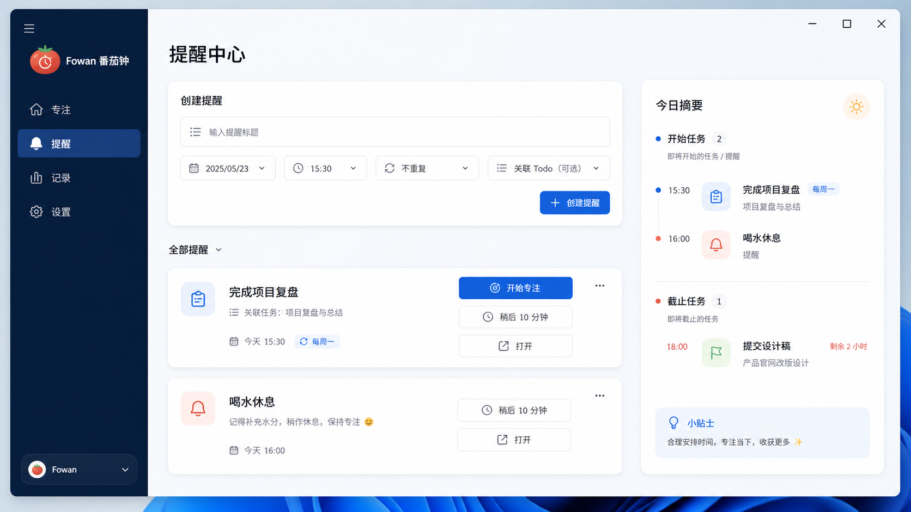

# Fowan Windows 番茄钟需求基准

## 产品定位

番茄钟是 Fowan 的独立 Windows 工具，用于执行标准番茄工作法、关联 Todo
任务并管理本地提醒。它不把计时、记录或效率统计嵌入 Todo，也不依赖 FowanCore、
网络、同步或云端服务。

## 视觉评审基准

以下两张已确认的 16:9 Fluent 概念图约束信息层级、布局和视觉气质；功能、数据和
失败行为仍以本文文字为准，发生冲突时以文字需求为先。

### 专注主屏

### 提醒中心

## 专注与记录

- 默认专注 25 分钟、短休息 5 分钟，每完成 4 个专注阶段进入 15 分钟长休息；三种
  时长和每轮专注数均可配置。
- 支持开始、暂停、继续、停止和跳过。只有自然完成的专注阶段增加轮次；停止与跳过
  记录为中断，不自动完成关联任务。
- 一个运行中的阶段可以关联零或一个未删除 Todo 任务。阶段结束后只显示“完成待办”
  操作，用户明确确认才修改 Todo。
- 窗口关闭、重启和睡眠后使用持久化结束时间恢复运行状态；离线结束的阶段只结算一次，
  不在后台连续推进后续阶段。
- 记录保存在本机，提供今日和本周完成专注次数、分钟数与记录列表，不提供效率评分、
  连续天数或图表看板。

## 提醒

- 独立提醒可设置标题、备注、相对时长或指定日期时间，并可选不重复、每周指定星期、
  每月指定 1-28 日；循环规则与 Todo 一致但独立保存。
- 一个 Todo 任务最多有一条有效提醒。关联已有有效提醒时，用户只能更新原提醒或取消。
- 新建独立提醒后询问是否创建或关联 Todo；“今日不再询问”在本地午夜失效，
  “以后不再询问”可在设置中恢复。
- 默认启用每日 09:30 的“今日截止任务”摘要；“今日开始任务”默认关闭，预填
  09:30。摘要仅包含未完成、未删除任务；时间相同则合并并去重。
- 任务完成或软删除暂停关联提醒；恢复为未完成时恢复由任务状态造成的暂停，手动关闭的
  提醒保持关闭。永久删除的任务不会把提醒转成独立提醒。
- 通知动作：任务提醒提供开始专注、稍后 10 分钟和打开；独立提醒提供稍后 10 分钟和
  打开。通知不得直接完成 Todo。

## 常驻与可靠性

- 提醒依赖 Toolbox 驻留。首次启用时询问是否自动启用登录时静默启动和关闭到托盘；
  用户拒绝后再次明确说明手动保持 Toolbox 驻留的责任。
- Toolbox 的正常启动不得启动或显示番茄钟界面；它只读取已持久化的下一唤醒时间，
  仅在提醒实际到期时才以无界面分发命令启动番茄钟。
- Toolbox 退出时提醒暂停；下次启动后，循环提醒按定义合并补发一次并显示错过次数，
  每日摘要只补当天。
- 提醒数据损坏时先备份原文件并进入只读故障状态，不以空数据覆盖原提醒。

## 数据与边界

- 番茄钟数据位于 `%LOCALAPPDATA%\\Fowan\\Pomodoro`，提醒数据位于
  `%LOCALAPPDATA%\\Fowan\\Reminders`；测试可分别使用 `FOWAN_POMODORO_DATA_ROOT`
  和 `FOWAN_REMINDER_DATA_ROOT` 隔离。
- Todo JSON 格式不新增提醒字段。Todo 仅通过共享 Reminder 服务展示和编辑关联提醒。
- 所有本地写入必须使用命名互斥量和原子替换；跨 Todo/Reminder 的操作在失败时保留
  已成功的主操作，并在下次激活时重新核对修复。
